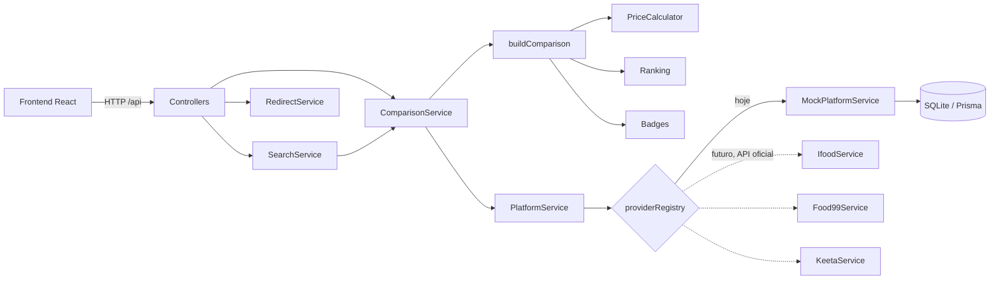
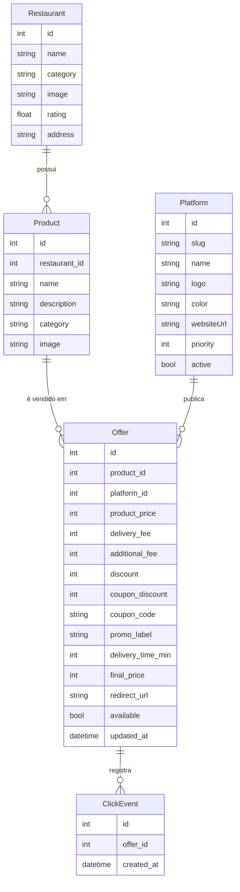
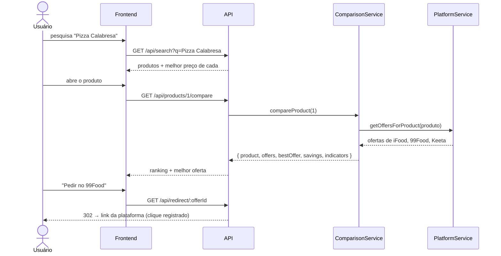

# 🍔 ComparaFood

> **Compare antes de pedir.** Você não precisa abrir três aplicativos para descobrir onde seu pedido está mais barato — nós fazemos a comparação para você.

ComparaFood é um MVP acadêmico que pesquisa um produto de fast food e mostra **em qual plataforma de delivery (iFood, 99Food, Keeta…) ele sai mais barato considerando o preço final** — produto, taxa de entrega, outras taxas, descontos e cupons.

    

---

## Sumário

1. [O problema](#1-o-problema)
2. [A solução](#2-a-solução)
3. [Como executar](#3-como-executar)
4. [Roteiro de demonstração](#4-roteiro-de-demonstração)
5. [Tecnologias](#5-tecnologias)
6. [Arquitetura](#6-arquitetura)
7. [Banco de dados](#7-banco-de-dados)
8. [Fluxo da aplicação](#8-fluxo-da-aplicação)
9. [Regras de negócio](#9-regras-de-negócio)
10. [API](#10-api)
11. [Testes](#11-testes)
12. [Dados de demonstração](#12-dados-de-demonstração)
13. [Limitações atuais](#13-limitações-atuais)
14. [Evoluções futuras](#14-evoluções-futuras)

---

## 1. O problema

Um mesmo restaurante costuma estar em várias plataformas de delivery, e **o mesmo produto tem preço final diferente em cada uma** por causa de:

- preço do produto diferente por plataforma;
- taxa de entrega e taxas adicionais (serviço, embalagem);
- descontos da plataforma ou do restaurante;
- cupons e promoções;
- combos exclusivos.

Para descobrir a opção mais barata, o cliente precisa abrir vários aplicativos, montar o carrinho em cada um e comparar manualmente. Na prática, quase ninguém faz isso — e paga mais caro.

## 2. A solução

O ComparaFood centraliza as ofertas e **calcula automaticamente o preço final** em cada plataforma:

| Plataforma | Produto  | Entrega | Desconto | **Total**    |
| ---------- | -------: | ------: | -------: | -----------: |
| iFood      | R$ 49,90 | R$ 8,00 |  R$ 5,00 | R$ 52,90     |
| **99Food** | R$ 49,90 | R$ 3,00 | R$ 15,00 | **R$ 37,90** 🏆 |
| Keeta      | R$ 47,90 | R$ 6,00 |  R$ 5,00 | R$ 48,90     |

> 🏆 **Melhor oferta: 99Food — R$ 37,90.** Você economiza **R$ 15,00** em relação à opção mais cara. **[PEDIR NO 99FOOD]**

O usuário vê o ranking, a melhor oferta em destaque, os indicadores (melhor preço, maior economia, plataformas comparadas, maior desconto), o cálculo detalhado de cada opção e um botão que o leva direto à plataforma vencedora.

## 3. Como executar

**Pré-requisito:** Node.js 20 ou superior.

```bash
npm run setup   # instala dependências, cria o .env e o banco SQLite com dados de demonstração
npm run dev     # sobe API (porta 3333) e frontend (porta 5173)
```

Acesse **http://localhost:5173**.

> `npm run dev` também verifica se o banco existe e o cria automaticamente — o projeto inicia corretamente do zero.

| Comando              | O que faz                                                         |
| -------------------- | ----------------------------------------------------------------- |
| `npm run setup`      | Instala tudo e cria/popula o banco                                |
| `npm run dev`        | Ambiente de desenvolvimento (API + frontend com hot reload)       |
| `npm test`           | Executa os testes automatizados (banco de teste separado)         |
| `npm run db:reset`   | Apaga o banco e recria com os dados de demonstração originais     |
| `npm run build`      | Compila backend e frontend                                        |
| `npm start`          | Modo produção: a API serve também o frontend em http://localhost:3333 |
| `npm run typecheck`  | Verificação de tipos do backend e do frontend                     |
| `npm run db:studio -w backend` | Abre o Prisma Studio para inspecionar o banco           |

Configurações ficam em `backend/.env` (criado a partir de [`backend/.env.example`](backend/.env.example)).

## 4. Roteiro de demonstração

1. **Home** — mostre a proposta, as categorias, as ofertas em destaque e o card "Análise de dados" (nenhuma plataforma é sempre a mais barata).
2. **Pesquise "Pizza Calabresa"** → a Pizzaria B aparece em primeiro com "Melhor preço · 99Food R$ 37,90".
3. **Abra o produto** → 🏆 Melhor oferta 99Food R$ 37,90, economia de R$ 15,00, indicadores e ranking 🥇 99Food R$ 37,90 · 🥈 Keeta R$ 48,90 · 🥉 iFood R$ 52,90. Abra "Ver cálculo do preço" e o gráfico de composição.
4. **Clique em "Pedir no 99Food"** → o clique é registrado e o usuário é redirecionado (página de pedido simulado).
5. Casos especiais:
   - **Pizza Margherita** — a Keeta tem o produto mais barato, mas o frete alto a deixa em último.
   - **Balde de Frango 12 pedaços** — o 99Food tem o produto mais caro, mas o maior desconto o faz vencer.
   - **X-Burger Clássico** — empate de preço final; troque o critério "Em caso de empate".
   - **Milkshake Ovomaltine** — disponível em apenas uma plataforma.
6. **Admin** (`/admin`) → aba *Ofertas*, edite a oferta da Keeta na Pizza Calabresa (ex.: desconto R$ 20,00). Volte ao produto: a Keeta passa a ser a vencedora — o preço final é recalculado automaticamente.
7. *Visão geral* do admin: vitórias por plataforma, preço médio, frete grátis e cliques em "Pedir".

## 5. Tecnologias

| Camada      | Escolha                              | Motivo                                                          |
| ----------- | ------------------------------------ | --------------------------------------------------------------- |
| Frontend    | **React 19 + TypeScript + Vite**     | Padrão de mercado, rápido, tipagem forte                        |
| Estilo      | **Tailwind CSS 4** + lucide-react    | Interface moderna e responsiva sem CSS espalhado                |
| Rotas       | React Router                         | Navegação SPA (home → busca → produto)                          |
| Backend     | **Node.js + Express + TypeScript**   | Simples de explicar; mesma linguagem no front e no back         |
| Validação   | Zod                                  | Validação declarativa dos dados do admin                        |
| Banco       | **SQLite**                           | Zero configuração — um arquivo; ideal para MVP/apresentação     |
| ORM         | **Prisma**                           | Schema legível, migração fácil para PostgreSQL no futuro         |
| Testes      | Vitest + Supertest                   | Testes unitários (regras) e de integração (API)                 |

A stack sugerida foi mantida: não havia alternativa significativamente melhor para este MVP.

## 6. Arquitetura

```
.
├── backend/
│   ├── prisma/
│   │   ├── schema.prisma          # modelo do banco
│   │   ├── seed-data.ts           # dados simulados (cenários de demonstração)
│   │   └── seed.ts                # popula o banco
│   ├── scripts/                   # criação de .env e do banco ao iniciar
│   ├── src/
│   │   ├── config/env.ts          # configurações (porta, desempate, provedores)
│   │   ├── database/
│   │   │   ├── client.ts          # Prisma Client
│   │   │   ├── mappers.ts         # banco → tipos de domínio
│   │   │   └── repositories/      # consultas ao banco
│   │   ├── services/
│   │   │   ├── pricing/           # PriceCalculator + aplicação de descontos
│   │   │   ├── ranking/           # ordenação e critérios de desempate
│   │   │   ├── comparison/        # ComparisonService + selos (badges)
│   │   │   ├── platforms/         # PlatformService, MockPlatformService, IfoodService…
│   │   │   ├── search/            # SearchService + categorias
│   │   │   ├── redirect/          # RedirectService (registro de cliques)
│   │   │   ├── stats/             # indicadores agregados
│   │   │   └── admin/             # validação e regras do admin
│   │   ├── controllers/           # traduzem HTTP ↔ serviços
│   │   ├── routes/                # rotas da API
│   │   ├── middlewares/           # tratamento de erros
│   │   ├── types/domain.ts        # tipos de domínio
│   │   ├── utils/                 # dinheiro, texto, HTTP
│   │   ├── app.ts / server.ts
│   └── tests/                     # testes unitários e de API
└── frontend/
    └── src/
        ├── components/            # layout, ui, search, comparison, home, admin
        ├── pages/                 # Home, Busca, Produto, Restaurante, Pedido simulado, Admin
        ├── services/              # cliente HTTP da API
        ├── hooks/                 # useAsync, useDocumentTitle
        ├── types/                 # tipos das respostas da API
        └── utils/                 # formatação de moeda, constantes
```

### Camadas e responsabilidades



**Princípios adotados**

- **Regras de negócio puras e independentes da interface**: `calculateFinalPrice`, `applyDiscounts`, `rankOffers` e `buildComparison` não conhecem banco nem HTTP — são testadas isoladamente.
- **Fonte de dados plugável**: todo provedor implementa `PlatformOfferProvider`. Hoje o `MockPlatformService` lê as ofertas simuladas do banco; no futuro, `IfoodService`, `Food99Service` e `KeetaService` usarão **APIs oficiais/autorizadas** — basta configurar `PLATFORM_PROVIDER_IFOOD=official` e as credenciais. Se uma integração falhar, a plataforma é ignorada e a comparação continua.
- **Injeção de dependências**: `ComparisonService` e `PlatformService` recebem suas dependências, o que permite testá-los com dados falsos.
- **Dinheiro em centavos**: todos os valores são inteiros (`4990` = R$ 49,90), evitando erros de ponto flutuante.
- **Sem scraping**: o projeto não tenta acessar dados das plataformas sem autorização.

## 7. Banco de dados



- `Offer.finalPrice` é **calculado pelo `PriceCalculator`** e armazenado para facilitar consultas; a comparação sempre recalcula a partir dos componentes (fonte da verdade).
- Um produto tem no máximo uma oferta por plataforma (`@@unique([productId, platformId])`).
- `ClickEvent` registra cada clique em "Pedir agora" — base para métricas de conversão e futuro programa de afiliados.
- Schema completo: [`backend/prisma/schema.prisma`](backend/prisma/schema.prisma).

## 8. Fluxo da aplicação

```
HOME → PESQUISA → RESULTADOS → PRODUTO → COMPARAÇÃO → MELHOR OFERTA → PEDIR AGORA → PLATAFORMA
```



## 9. Regras de negócio

1. **Preço final**
   `PREÇO FINAL = preço do produto + taxa de entrega + outras taxas − desconto − cupom`
   - valores negativos são tratados como zero;
   - os descontos nunca deixam o preço final negativo.
2. **Ranking**: ordena pelo menor preço final.
3. **Empate**: se duas ofertas têm o mesmo preço final, aplica-se o critério secundário configurável (`TIE_BREAKER` no `.env` ou seletor na tela): menor tempo de entrega (padrão), menor taxa de entrega, menor preço do produto ou `none` (exibe o empate, ambas em 1º lugar).
4. **Economia** = preço final da opção mais cara − preço final da melhor opção.
5. **Indicadores**: melhor preço, maior economia, plataformas comparadas, preço médio e maior desconto encontrado.
6. **Selos**:
   🏆 Melhor preço · 💰 Economize R$ X (na vencedora) · 🚚 Frete grátis (entrega = 0) · 🔥 Promoção (desconto ≥ 10% do produto ou selo cadastrado) · 🎟️ Cupom · ⚡ Entrega mais rápida · 🤝 Empate.
7. **Oferta única**: informa "Apenas uma oferta foi encontrada para este produto".
8. **Busca**: ignora acentos e maiúsculas; procura no nome do produto, restaurante, categoria (com sinônimos, ex.: "burger" → hambúrguer) e descrição; ordena por relevância e economia.
9. **Redirecionamento**: cada oferta tem um `redirectUrl` configurável no admin. Nos dados simulados ele aponta para uma página interna de pedido simulado; pode ser trocado por um link oficial/afiliado.

## 10. API

| Método | Rota                                   | Descrição                                     |
| ------ | -------------------------------------- | --------------------------------------------- |
| GET    | `/api/health`                          | Status da API                                 |
| GET    | `/api/search?q=&category=`             | Busca produtos e restaurantes                 |
| GET    | `/api/categories`                      | Categorias com contagem de produtos           |
| GET    | `/api/products/featured`               | Produtos com maior economia                   |
| GET    | `/api/products/:id/compare?tieBreaker=`| **Comparação completa de um produto**         |
| GET    | `/api/restaurants` / `/api/restaurants/:id` | Restaurantes e cardápio comparado        |
| GET    | `/api/platforms`                       | Plataformas ativas                            |
| GET    | `/api/stats/overview`                  | Indicadores agregados por plataforma          |
| GET    | `/api/redirect/:offerId`               | Registra o clique e redireciona (302)         |
| CRUD   | `/api/admin/{restaurants,products,platforms,offers}` | Área administrativa             |

Exemplo de resposta de `compare` (resumida):

```json
{
  "product": { "name": "Pizza Calabresa", "restaurant": { "name": "Pizzaria B" } },
  "offers": [
    { "position": 1, "platform": { "name": "99Food" }, "finalPrice": 3790, "badges": [{ "label": "🏆 Melhor preço" }] },
    { "position": 2, "platform": { "name": "Keeta" }, "finalPrice": 4890, "differenceFromBest": 1100 },
    { "position": 3, "platform": { "name": "iFood" }, "finalPrice": 5290, "differenceFromBest": 1500 }
  ],
  "bestOffer": { "platform": { "name": "99Food" }, "finalPrice": 3790, "redirectPath": "/api/redirect/2" },
  "savings": 1500,
  "indicators": { "bestPrice": 3790, "maxSavings": 1500, "platformsCompared": 3, "biggestDiscount": 1500 },
  "message": "99Food tem o menor preço final: R$ 37,90. Você economiza R$ 15,00 em relação à opção mais cara."
}
```

## 11. Testes

```bash
npm test
```

38 testes (Vitest + Supertest), incluindo os casos exigidos:

| Caso | Cenário                                       | Resultado esperado                                      |
| ---- | --------------------------------------------- | ------------------------------------------------------- |
| 1    | Produto em 3 plataformas                      | Menor preço final vence (99Food R$ 37,90)               |
| 2    | Preço maior, mas desconto maior               | Considera o preço final, não o original                 |
| 3    | Produto barato com frete alto                 | Frete entra no cálculo                                  |
| 4    | Duas plataformas com o mesmo preço            | Empate exibido **ou** critério secundário configurável  |
| 5    | Produto em apenas uma plataforma              | "Apenas uma oferta foi encontrada"                      |

Além disso: cálculo e limites de desconto, ranking, falha de uma plataforma sem derrubar a comparação, integrações oficiais desabilitadas sem credenciais, busca com acentos, fluxo completo da API (busca → comparação → redirecionamento com registro de clique) e CRUD do admin com recálculo do preço final. Os testes de API usam um banco separado (`prisma/test.db`), recriado a cada execução.

## 12. Dados de demonstração

6 restaurantes, 21 produtos, 3 plataformas e 53 ofertas ([`backend/prisma/seed-data.ts`](backend/prisma/seed-data.ts)):

| Restaurante     | Produtos                                                             |
| --------------- | -------------------------------------------------------------------- |
| Pizzaria B      | Pizza Calabresa, Pizza Margherita, Pizza Portuguesa, Coca-Cola 2L   |
| Burger House    | Combo Bacon, X-Burger Clássico, Smash Burger Duplo, Milkshake Ovomaltine |
| Frango Express  | Balde de Frango 12 pedaços, Combo Frango Crocante, Tirinhas de Frango, Suco Natural |
| Mega Lanches    | X-Tudo, Misto Quente, Hot Dog Completo, Combo Mega Família           |
| Sushi House     | Combo Sushi 30 peças, Temaki de Salmão, Hot Roll 10 peças           |
| Brasa Burger    | Burger Costela, Combo Brasa Duplo                                    |

Cenários incluídos de propósito: plataforma com menor preço de produto que perde por causa do frete, plataforma com produto mais caro que vence pelo desconto, frete grátis, cupons, empate de preço final, vitória por diferença de R$ 0,01 (Pizza Portuguesa) e produto com uma única oferta. Todos os produtos estão em pelo menos 2 plataformas, exceto o Milkshake, mantido em uma só para demonstrar o caso 5.

> Observação: no exemplo do enunciado aparecem duas economias diferentes (R$ 11,00 e R$ 15,00). O sistema usa a definição "em relação à opção mais cara": R$ 52,90 − R$ 37,90 = **R$ 15,00**. R$ 11,00 é a diferença para a segunda colocada (Keeta), exibida no ranking como "+R$ 11,00 que a melhor".

## 13. Limitações atuais

- **Dados simulados**: preços, descontos e links não refletem as plataformas reais.
- Sem integração com APIs oficiais (a arquitetura está pronta, mas depende de parcerias/credenciais).
- Não considera localização do usuário, área de entrega, horário de funcionamento ou disponibilidade em tempo real.
- Compara um único item por vez (não um carrinho com vários itens).
- Área administrativa **sem autenticação** (apenas para demonstração).
- Busca em memória — adequada para dezenas/centenas de produtos; em escala exigiria índice de busca (ex.: full-text no PostgreSQL ou Meilisearch).
- Links de "Pedir agora" levam a uma página de pedido simulado.

## 14. Evoluções futuras

- **Integração com APIs oficiais** ou fontes de dados autorizadas (programas de parceiros/afiliados).
- **Localização do usuário**, cálculo de distância e disponibilidade por região.
- **Comparação de carrinho** (vários itens), combos e restaurantes.
- **Histórico de preços e de promoções**, com gráficos de evolução e análise histórica.
- **Alertas de queda de preço** e **favoritos**.
- **Cupons** agregados e aplicados automaticamente.
- **Inteligência artificial** para recomendar a melhor opção (preço × tempo × avaliação) e **prever os melhores horários** para pedir.
- **Aplicativos Android e iOS** (ex.: React Native reaproveitando a API e as regras de negócio).
- **Sistema de avaliação** dos restaurantes/plataformas.
- **Programa de afiliados** usando os cliques já registrados (`ClickEvent`) como base de monetização.
- Autenticação e perfis de acesso na área administrativa; migração do SQLite para PostgreSQL.

---

Projeto acadêmico. iFood, 99Food e Keeta são marcas de seus respectivos proprietários; este projeto não possui vínculo com elas.
